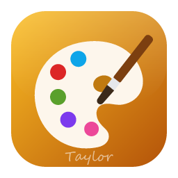

<p align="center">
  
</p>

<h1 align="center">Local Paint</h1>

<p align="center">
  <b>Image editing; an open-source, clean-room image editor built in pure Rust.</b><br>
  Layers, masks, adjustment layers, layer styles, type, vectors, brushes and real PSD files,<br>
  in a native app written entirely in Rust. Offline, and yours.
</p>

<p align="center">
  
  
  
  <br>
</p>

<p align="center">
  <a href="https://github.com/Anon5T4R/Local-Paint"><b>Local Paint on GitHub</b></a> ·
  <a href="https://github.com/Anon5T4R/">Local</a> ·
  <a href="https://github.com/Anon5T4R">Anon5T4R</a>
</p>

<br>

---

## Get it

Installers are attached to each [GitHub release](https://github.com/Anon5T4R/Local-Paint/releases) of
this repository. There is no store, no account and no telemetry: the app never talks to a server of
ours, and the only network access is the update check against GitHub's public latest-release
endpoint (Preferences › General disables it).

| Platform | Files |
|---|---|
| Windows 10+ x64 / x86 | `localpaint-<ver>-windows-<arch>.msi` (per-machine, installs in `Program Files\Local Paint`) and `localpaint-<ver>-windows-<arch>-portable.zip` |
| Linux x86_64 / aarch64 | `.AppImage`, `.deb`, `.rpm`, `.tar.gz`, and the standalone CLI tarball (`packaging/linux/package.sh`) |
| Arch Linux | `packaging/arch/PKGBUILD` |
| macOS, FreeBSD, web (WebAssembly) | built by the scripts in `packaging/` |

## Everything in the box

<h4>🧰 68 tools</h4>
Move · Artboard · Rectangular Marquee · Elliptical Marquee · Single Row Marquee · Single Column Marquee · Brush · Pencil · Mixer Brush · Color Replacement · Eraser · Background Eraser · Magic Eraser · Eyedropper · Color Sampler · Ruler · Note · Count · Lasso · Polygonal Lasso · Magnetic Lasso · Magic Wand · Crop · Perspective Crop · Slice · Slice Select · Frame · Gradient · Paint Bucket · Horizontal Type · Vertical Type · Horizontal Type Mask · Vertical Type Mask · Hand · Rotate View · Zoom · Remove · Spot Healing Brush · Healing Brush · Patch · Content-Aware Move · Red Eye · Clone Stamp · Pattern Stamp · History Brush · Art History Brush · Blur · Sharpen · Smudge · Dodge · Burn · Sponge · Quick Selection · Object Selection · Pen · Freeform Pen · Curvature Pen · Add Anchor Point · Delete Anchor Point · Convert Point · Path Selection · Direct Selection · Rectangle · Ellipse · Triangle · Polygon · Line · Custom Shape

## Build

```sh
git clone https://github.com/Anon5T4R/Local-Paint
cd Local-Paint
cargo run --release -p localpaint            # the desktop app
cargo test --workspace                       # the test suite
```

Japanese and CJK fonts for the UI and the Type tool come from
[craft-fonts](https://github.com/storytold/craft-fonts), vendored under `assets/craft-fonts/` (the
release builds and CI pass it as `CRAFT_FONTS_DIR`). Without it the app uses your system's fonts.

Maintainers cut releases by pushing a `vX.Y.Z` tag; [`docs/releasing.md`](docs/releasing.md)
describes what the workflow builds and publishes. Contributors and agents start with
[`AGENTS.md`](AGENTS.md), then [`docs/`](docs/) and the [documentation book](book/).

## License and credits

Local Paint is dual-licensed under [MIT](LICENSE-MIT) or [Apache-2.0](LICENSE-APACHE), at your option.
Copyright (c) 2026 Local Team and the Local Paint contributors; the upstream copyright line is kept in
[`LICENSE-MIT`](LICENSE-MIT). Required notices are in [NOTICE](NOTICE).

Bundled fonts, icons, images and other assets keep their own open licenses; each one is listed
with its author, source and license in [ATTRIBUTION.md](ATTRIBUTION.md). Release builds also embed
the fonts of [craft-fonts](https://github.com/storytold/craft-fonts/blob/main/ATTRIBUTION.md)
(SIL Open Font License 1.1).

Fork independente, mantido por Anon5T4R na suíte Local. Créditos de código originais em [ATTRIBUTION.md](ATTRIBUTION.md).

<p align="center">
  <sub>Suíte Local — apps locais, sem conta, sem telemetria.</sub>
</p>
