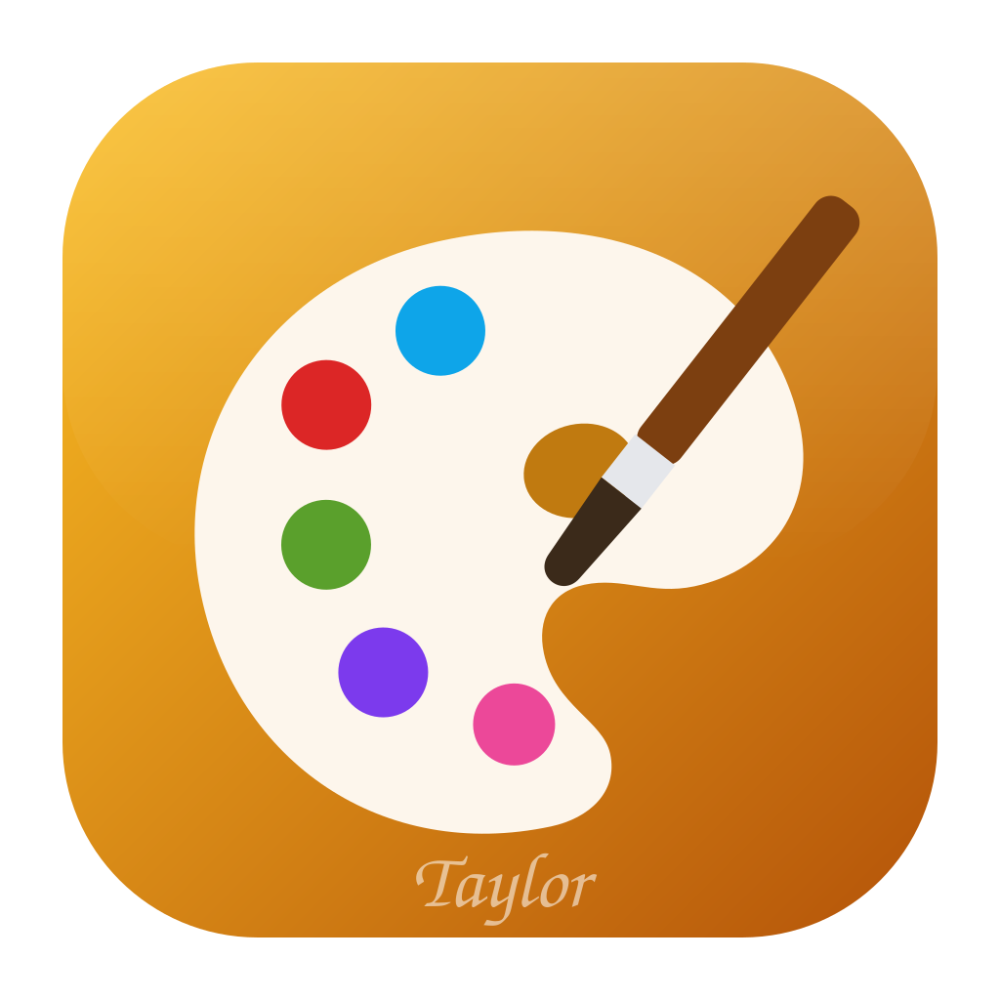

# Local Paint app icon

**Figure:** a painter's palette (a rim shape with a thumb hole) holding five ink blobs, with a
brush crossing it — the mark that tells Local Paint apart from the other apps of the suite.

**Style:** flat shapes on a full-bleed amber gradient tile — the same language as the rest of the
Local suite's icons.

**Palette:**

| Colour | Hex | Used for |
|---|---|---|
| Amber | `#fbbf24` → `#b45309` | gradient of the tile (top-left to bottom-right) |
| Paper | `#fdf6ec` | the palette |
| Ochre | `#c07a10` | the thumb hole |
| Red, blue, green, violet, pink | `#dc2626`, `#0ea5e9`, `#5aa02c`, `#7c3aed`, `#ec4899` | the ink blobs |
| Wood, steel, bristles | `#7c3f10`, `#e5e7eb`, `#3b2a1a` | the brush |
| White at 55% | `#ffffff` | the signature "Taylor" at the tile's foot |

**Tile:** `viewBox="0 0 1024 1024"`, a rounded square inset 64 units with `rx=200`. Windows and
Linux icons use the whole tile; the macOS renders use it as it is, its 64-unit margin standing in
for Apple's 824/1024 body grid.

**Provenance:** the project owner's original SVG (`source-localpaint.svg` in the owner's icon
repo), used as the master vector. Licence: [LICENSE.txt](LICENSE.txt) (`MIT OR Apache-2.0`, like
the repo).

## Files

| File | What it is |
|---|---|
| `localpaint.svg` | the master vector (the project owner's source SVG); every PNG, `.ico` and `.icns` is rendered from it |
| `localpaint-small.svg` | the same master under the name the READMEs link |
| `localpaint-1024.png` | the runtime Dock icon on macOS: the owner's largest raster (`icon.png`, 512 px — the set has no 1024 px render yet) |
| `localpaint.icns` | macOS icon (16–1024 px) |
| `localpaint.ico` | Windows icon, 16–256 px; embedded in `localpaint.exe` by `apps/localpaint/build.rs` |
| `hicolor/<n>x<n>/apps/com.localpaint.app.png` | Linux hicolor theme, 16–512 px; the 256 px one is the runtime icon on Windows and Linux |
| `hicolor/scalable/apps/com.localpaint.app.svg` | Linux scalable icon (copy of the master) |

Where it shows: `apps/localpaint/src/main.rs` sets the window icon (Dock, taskbar, Alt-Tab,
launcher) and the Wayland app id `com.localpaint.app`; `packaging/linux/com.localpaint.app.desktop`
names the hicolor icon; the MSI's Start Menu and desktop shortcuts and its Add/Remove Programs
entry use `localpaint.ico`.

## Regenerate

Replace `localpaint.svg` (and `localpaint-small.svg`) with the master, then run
`packaging/icons.sh`. It needs `resvg`, plus `iconutil` on macOS; the `.ico` is packed by
`cargo xtask ico`.
